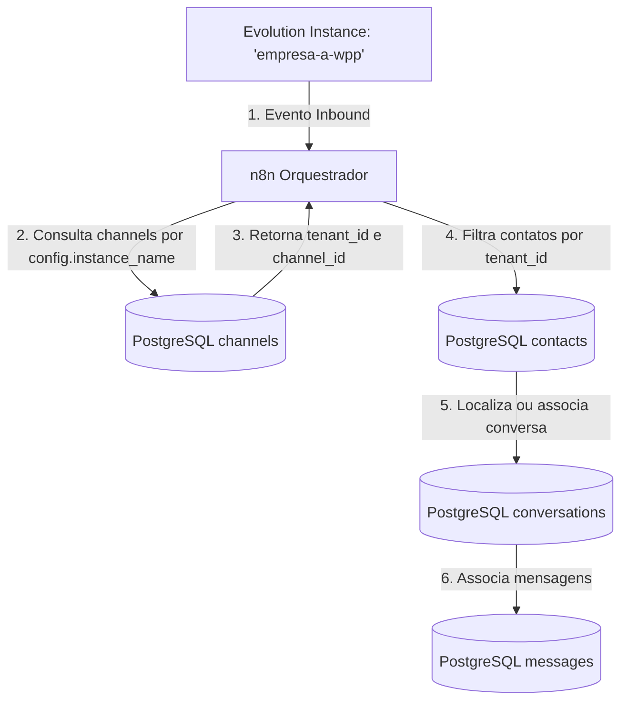

# Arquitetura de Resolução de Instância e Multi-Tenancy

## Fluxo de Resolução de Instância para Tenant

A identificação do Tenant **NÃO** depende apenas do telefone do usuário final. O isolamento multi-tenant do SDTech Soluctions é determinado a partir do mapeamento da **Instância da Evolution API** para o **Canal do Tenant**.



---

## Mapeamento de Entidades (Cadeia Referencial)

```
Evolution Instance ('empresa-a-wpp')
       ↓
Tenant ('tenant_id': 'aaaaaaaa-0000-0000-0000-000000000001')
       ↓
Channel ('channel_id': 'aaaaaaaa-3333-0000-0000-000000000001', type: 'whatsapp')
       ↓
Conversation ('conversation_id': 'aaaaaaaa-4444-0000-0000-000000000001')
       ↓
Contact ('contact_id': 'aaaaaaaa-2222-0000-0000-000000000001', phone: '+5511999999999')
```

---

## Estrutura da Tabela `channels` para Resolução de Instância

A resolução de instância é realizada através de consulta parametrizada ao JSONB da tabela `channels`:

```sql
SELECT
    c.id AS channel_id,
    c.tenant_id,
    c.name AS channel_name,
    c.status AS channel_status,
    t.name AS tenant_name,
    t.status AS tenant_status
FROM channels c
JOIN tenants t ON t.id = c.tenant_id
WHERE c.type = 'whatsapp'
  AND c.status = 'active'
  AND t.status = 'active'
  AND c.config->>'instance_name' = $1::text;
```

---

## Garantias de Isolamento Multi-Tenant

1. **Separação por Instância:** Instâncias da Evolution API são dedicadas ou isoladas logicamente por tenant.
2. **Rejeição de Instância Desconhecida:** Se uma mensagem chegar de uma instância não cadastrada na tabela `channels` de nenhum tenant ativo, o evento é descartado e registrado no `audit_logs` como `channel.unmapped_instance`.
3. **Impossibilidade de Contaminação Cruzada:** Mesmo se um contato tiver o mesmo número de telefone em dois tenants diferentes, o evento será atribuído estritamente ao `tenant_id` da instância que recebeu a mensagem.
