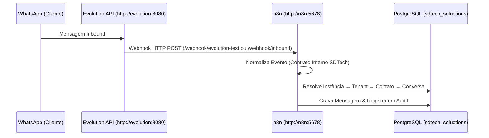

# Especificação do Webhook — Evolution API → n8n Core

## Visão Geral da Integração

A **Evolution API** atua como a camada de abstração de conectividade com a rede do WhatsApp. Ela traduz eventos recebidos do WhatsApp em payloads HTTP `POST` (Webhooks) enviados ao **n8n Core**.



---

## Eventos de Interesse do WhatsApp

A Evolution API gera diversos eventos. Para o SDTech Soluctions V1.0, os eventos cadastrados para escuta são estritamente delimitados:

| Evento Evolution API | Descrição | Utilização no SDTech Soluctions |
|----------------------|-----------|----------------------------------|
| `MESSAGES_UPSERT` (`messages.upsert`) | Mensagem recebida ou enviada | Ingestão principal de mensagens do cliente |
| `MESSAGES_UPDATE` (`messages.update`) | Atualização de status da mensagem | Confirmação de entrega/leitura (`SENT`, `DELIVERED`, `READ`) |
| `CONNECTION_UPDATE` (`connection.update`) | Mudança no estado da conexão WhatsApp | Monitoramento e alerta de desconexão da instância |
| `QRCODE_UPDATED` (`qrcode.updated`) | Novo QR Code gerado para pareamento | Suporte a onboarding e reconexão de instâncias |

---

## Contrato de Normalização Interna (SDTech Soluctions)

O n8n é responsável por receber o payload nativo da Evolution API e transformá-lo na **Estrutura Normalizada Interna** do SDTech Soluctions:

```json
{
  "source": "evolution_api",
  "event": "messages.upsert",
  "instance": "empresa-wpp-01",
  "received_at": "2026-08-19T09:58:00Z",
  "tenant_id": null,
  "contact": {
    "phone": "+5511999999999",
    "name": "João Silva"
  },
  "message": {
    "id": "TEST_MESSAGE_001",
    "type": "text",
    "direction": "inbound",
    "text": "Mensagem de teste de entrada",
    "timestamp": "2026-08-19T09:58:00Z"
  },
  "raw_event": {
    "event": "messages.upsert",
    "instance": "empresa-wpp-01"
  }
}
```

> [!NOTE]
> O campo `tenant_id` permanece nulo no evento bruto normalizado até que o workflow de **Instance Resolution** associe a instância da Evolution API ao Tenant correspondente na tabela `channels`.

---

## Estratégias de Segurança do Webhook

Para garantir que apenas a Evolution API autorizada envie dados ao n8n:

1. **Header de Autenticação / Token:** Utilização de header HTTP personalizado (ex: `apikey: <EVOLUTION_API_TOKEN>`).
2. **Secret do Webhook:** Token de validação assinado pelo emissor (`<N8N_WEBHOOK_SECRET>`).
3. **Isolamento em Rede Privada:** O tráfego de webhook trafega exclusivamente na rede Docker `sdtech-net` (`http://n8n:5678/webhook/...`), sem exposição direta da porta do webhook para a internet pública sem passar pelo proxy reverso.
4. **HTTPS:** Em ambientes expostos externamente, utilização obrigatória de SSL/TLS via Nginx Proxy Manager e Cloudflare.

---

## Estratégia de Idempotência

Devido à natureza assíncrona das redes móveis, eventos de mensagens podem ser entregues em duplicidade pela Evolution API.

- **Mecanismo de Deduplicação:** O campo `external_message_id` (que contém o `key.id` da mensagem do WhatsApp) possui o índice `uq_messages_external_per_conversation` no PostgreSQL.
- Se uma mensagem com o mesmo `external_message_id` for processada novamente dentro da mesma conversa, a inserção é ignorada com segurança via `ON CONFLICT (conversation_id, external_message_id) DO NOTHING`.
