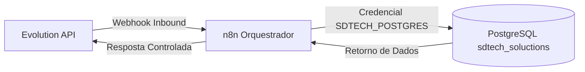

# Arquitetura de Orquestração — n8n Core V1.0

## Diagrama da Camada de Orquestração

---

## Princípios de Orquestração

1. **Desacoplamento:** O n8n recebe webhooks da Evolution API, traduz requisições e consulta a base de dados central, mantendo o controle do estado do atendimento.
2. **Segurança Multi-Tenant:** Toda query executada no PostgreSQL inclui a cláusula `WHERE tenant_id = $1::uuid`.
3. **Imutabilidade de Registros:** Mensagens e audit logs gravados via n8n são imutáveis.
4. **Resiliência a Erros:** Erros na Evolution API ou no banco de dados ativam ramificações de fallback com captura e formatação padronizada.
