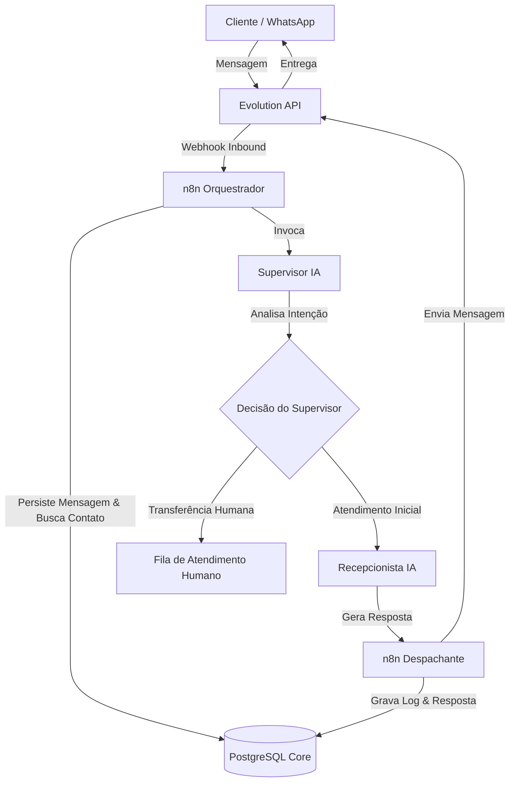

# Arquitetura de Alto Nível — SDTech Soluctions

## Visão Geral do Fluxo de Atendimento

O fluxo de mensagens do SDTech Soluctions foi projetado para ser resiliente, auditável e altamente extensível.

---

## Detalhamento das Camadas

### 1. Camada de Entrada (Canal)
- **Evolution API:** Recebe as mensagens via WhatsApp e as encaminha como webhooks para o n8n.
- Responsável por gerenciar conexões via QR Code, instâncias e eventos de conexão.

### 2. Camada de Orquestração (n8n)
- Valida o payload de entrada.
- Garante que os dados sejam isolados pelo `tenant_id`.
- Interage com o banco PostgreSQL via usuário seguro `sdtech_app`.
- Coordena as chamadas para os serviços de IA e envios externos.

### 3. Camada de Inteligência Artificial (Agentes)
- **Supervisor IA:** Monitora o ciclo da conversa (`agent_sessions`). Avalia se a conversa deve ser conduzida por uma IA específica ou se exige intervenção de um atendente humano.
- **Recepcionista IA:** Executa a interação em linguagem natural com o cliente, tirando dúvidas, realizando triagem e coletando informações.

### 4. Camada de Dados (PostgreSQL `sdtech_soluctions`)
- Armazena todas as entidades operacionais: `tenants`, `users`, `contacts`, `channels`, `conversations`, `messages`, `agents`, `agent_sessions`, `audit_logs`.
- Mantém o registro histórico imutável das mensagens e auditoria.
