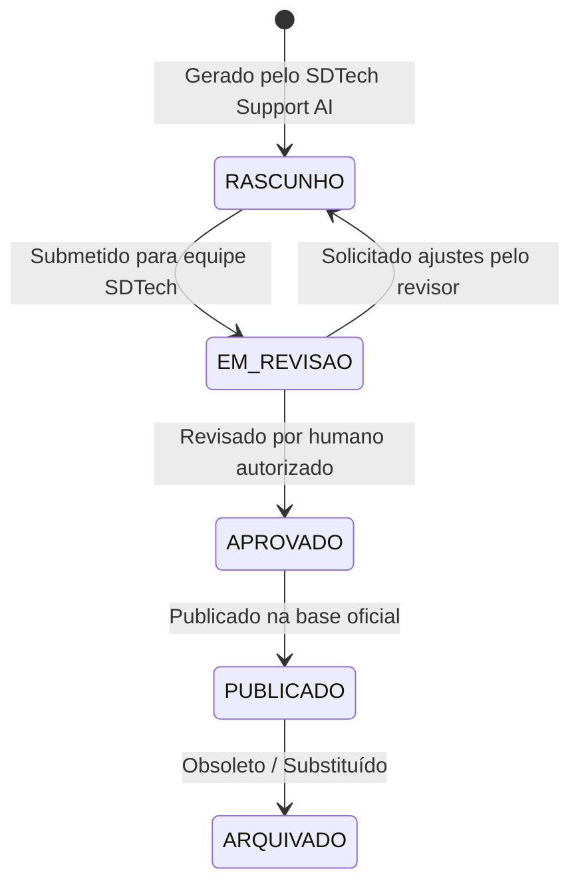

# SDTech Support AI — Especificação do Agente Interno da Plataforma

> **Status:** Arquitetura Registrada (Implementação Futura)  
> **Escopo do Agente (`agent_scope`):** `PLATFORM`  
> **Responsabilidade:** Suporte interno, auxílio a usuários e auxílio na documentação do SDTech Soluctions.

---

## 🎯 Objetivo

O **SDTech Support AI** é um agente interno dedicado ao suporte e sucesso do cliente na própria plataforma SDTech Soluctions. Ele não atua como atendente dos clientes do tenant, mas sim como o especialista assistente da SDTech para os usuários e administradores da plataforma.

---

## ⏱️ Fase Inicial de Operação (Primeiros 90 Dias)

Durante os primeiros **90 dias** de lançamento, o agente operará estritamente em **regime de aprendizagem supervisionada**, alimentando sua base de conhecimento e refinando suas respostas a partir de:

1. **Dúvidas dos Usuários:** Perguntas frequentes enviadas ao suporte.
2. **Tickets de Atendimento:** Histórico de chamados resolvidos.
3. **Conversas e Atendimentos:** Diálogos reais com suporte humano.
4. **Resoluções Concluídas:** Soluções aceitas e validadas por atendentes.
5. **Feedback Humano:** Avaliações de respostas (thumbs up / thumbs down e correções manuais).
6. **Documentação Oficial:** Base de conhecimento e guias do SDTech Soluctions.

---

## 🧠 Capacidades Futuras do Agente

Quando ativado para produção, o **SDTech Support AI** será capaz de:

- **Responder Dúvidas:** Prestar suporte em tempo real sobre o uso da plataforma.
- **Identificar Problemas:** Diagnosticar falhas de configuração reportadas por usuários.
- **Orientar Usuários:** Guiar administradores na criação de canais, agentes e cadastros.
- **Sugerir FAQ:** Identificar dúvidas recorrentes e propor novos itens para a FAQ oficial.
- **Criar Rascunhos de FAQ:** Redigir rascunhos de perguntas e respostas para aprovação.
- **Criar Rascunhos de Documentação de Onboarding:** Gerar materiais de treinamento para novos tenants.
- **Identificar Lacunas na Documentação:** Detectar temas em que os usuários encontram dificuldades e onde a documentação oficial é escassa.
- **Sugerir Melhorias:** Propor melhorias contínuas de UX e documentação com base nos padrões de dúvidas.

---

## 🔄 Fluxo de Governança de Documentos

Toda e qualquer documentação criada ou sugerida pelo agente seguirá obrigatoriamente o seguinte ciclo de vida:

---

## 🔒 Restrições Críticas de Segurança e Modificação

> [!CAUTION]
> **RESTRICAO ABSOLUTA DE SEGURANÇA:**
> - O **SDTech Support AI** **NÃO PODE** publicar ou alterar documentações oficiais críticas sem aprovação autorizada por um usuário com perfil administrativo (`is_platform_admin`).
> - O agente opera como **gerador de rascunhos e orientador**, exigindo sempre a etapa de aprovação humana no fluxo de governança.
