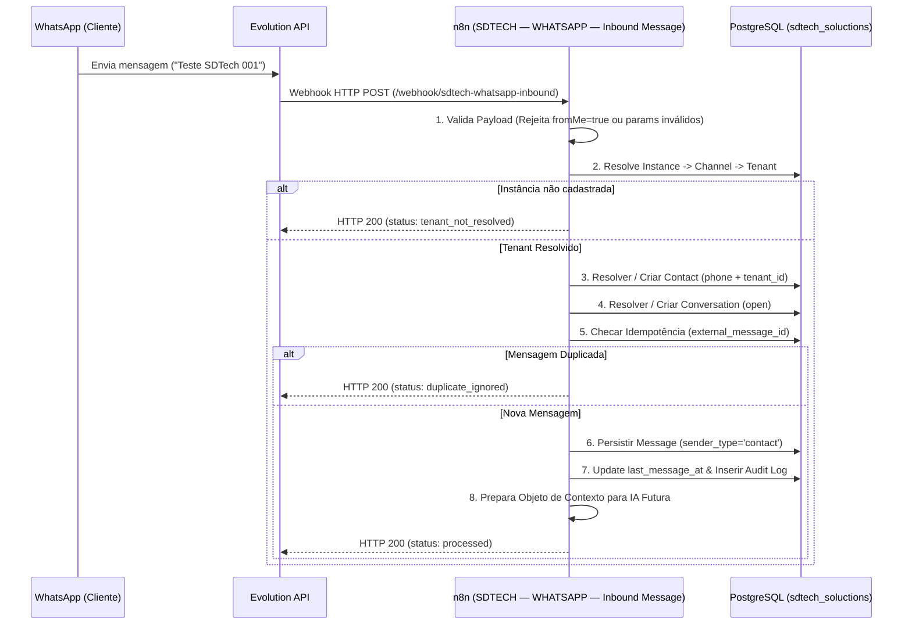

# Arquitetura de Entrada de Mensagens WhatsApp (Inbound Message Flow)

## Visão Geral do Fluxo Real Inbound

O fluxo real de ingestão de mensagens do WhatsApp no **SDTech Soluctions V1.0** opera sem intervenção de IA nesta etapa, garantindo a resolução estrita de Tenant, Contato, Conversa e Persistência da Mensagem no PostgreSQL com controle de idempotência e log de auditoria.

---

## Mapeamento Transacional Detalhado

1. **Validação de Entrada:**
   - Descarta mensagens enviadas pelo próprio usuário do sistema (`fromMe = true`).
   - Processa apenas eventos do tipo `messages.upsert` (ou `MESSAGES_UPSERT`).
2. **Resolução de Instância / Tenant:**
   - Consulta `channels` filtrando por `config->>'instance_name' = $1` e `status = 'active'`.
   - Obtém `tenant_id` e `channel_id`.
3. **Resolução de Contato (`contacts`):**
   - Procura por `(tenant_id, phone)`. Se não existir, cria novo contato atrelado ao `tenant_id`.
4. **Resolução de Conversa (`conversations`):**
   - Busca conversa com `status IN ('open', 'pending')` para `(tenant_id, contact_id, channel_id)`. Se não existir, cria com `status = 'open'` e `ai_enabled = true`.
5. **Deduplicação / Idempotência:**
   - Consulta se `external_message_id` já existe na conversa. Se sim, desvia e retorna `DUPLICATE_IGNORED`.
6. **Persistência de Mensagem (`messages`):**
   - Grava mensagem com `sender_type = 'contact'`, `external_message_id` original do WhatsApp e metadados.
7. **Atualização & Auditoria:**
   - Atualiza `conversations.last_message_at = now()`.
   - Insere evento em `audit_logs` (`action = 'WHATSAPP_MESSAGE_RECEIVED'`).
8. **Saída Estruturada:**
   - Retorna HTTP 200 e deixa o objeto `ai_context` pronto para consumo do futuro **Supervisor IA**.
