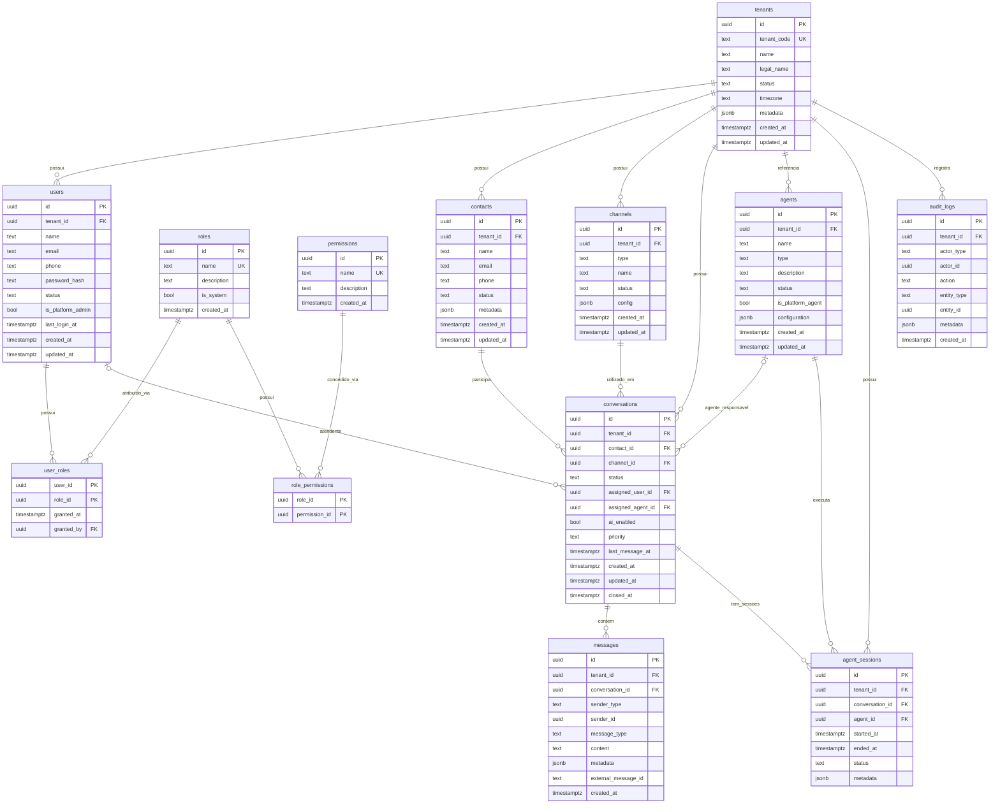
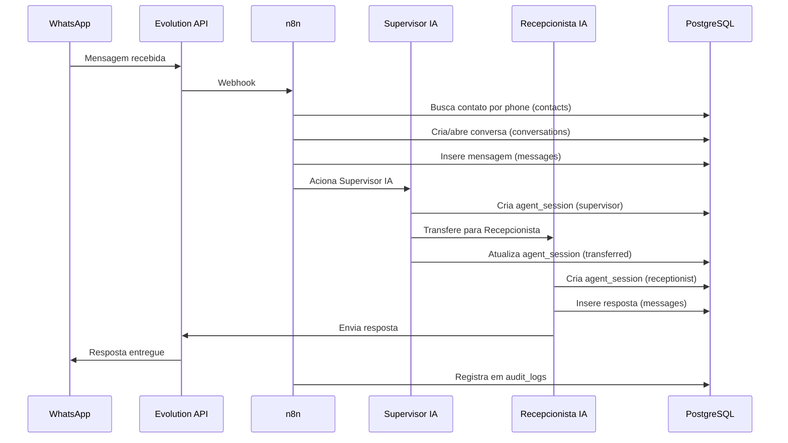

# SDTech Soluctions — Modelo Lógico do Banco (Schema V1.0)

## Diagrama de Entidade-Relacionamento

---

## Detalhamento das Tabelas

### tenants

| Coluna | Tipo | Null | Default | Descrição |
|--------|------|------|---------|-----------|
| id | UUID | NOT NULL | gen_random_uuid() | PK interna |
| tenant_code | TEXT | NULL | — | Identificador externo (hash pendente) |
| name | TEXT | NOT NULL | — | Nome comercial |
| legal_name | TEXT | NULL | — | Razão social |
| status | TEXT | NOT NULL | 'active' | active \| suspended \| inactive |
| timezone | TEXT | NOT NULL | 'America/Sao_Paulo' | Fuso horário |
| metadata | JSONB | NOT NULL | '{}' | Dados adicionais variáveis |
| created_at | TIMESTAMPTZ | NOT NULL | now() | Criação |
| updated_at | TIMESTAMPTZ | NOT NULL | now() | Atualização (auto-trigger) |

### users

| Coluna | Tipo | Null | Default | Descrição |
|--------|------|------|---------|-----------|
| id | UUID | NOT NULL | gen_random_uuid() | PK |
| tenant_id | UUID | NULL | — | FK tenants.id (NULL = platform_admin) |
| name | TEXT | NOT NULL | — | Nome completo |
| email | TEXT | NOT NULL | — | Email (único por tenant) |
| phone | TEXT | NULL | — | Telefone |
| password_hash | TEXT | NOT NULL | — | Bcrypt hash |
| status | TEXT | NOT NULL | 'active' | active \| inactive \| suspended |
| is_platform_admin | BOOLEAN | NOT NULL | false | ADM Master SDTech |
| last_login_at | TIMESTAMPTZ | NULL | — | Último login |
| created_at | TIMESTAMPTZ | NOT NULL | now() | Criação |
| updated_at | TIMESTAMPTZ | NOT NULL | now() | Atualização |

### contacts

| Coluna | Tipo | Null | Default | Descrição |
|--------|------|------|---------|-----------|
| id | UUID | NOT NULL | gen_random_uuid() | PK |
| tenant_id | UUID | NOT NULL | — | FK tenants.id |
| name | TEXT | NOT NULL | — | Nome do contato |
| email | TEXT | NULL | — | Email |
| phone | TEXT | NOT NULL | — | Telefone (único por tenant) |
| status | TEXT | NOT NULL | 'active' | active \| blocked \| archived |
| metadata | JSONB | NOT NULL | '{}' | Tags, origem, campos custom |
| created_at | TIMESTAMPTZ | NOT NULL | now() | Criação |
| updated_at | TIMESTAMPTZ | NOT NULL | now() | Atualização |

### channels

| Coluna | Tipo | Null | Default | Descrição |
|--------|------|------|---------|-----------|
| id | UUID | NOT NULL | gen_random_uuid() | PK |
| tenant_id | UUID | NOT NULL | — | FK tenants.id |
| type | TEXT | NOT NULL | — | whatsapp \| instagram \| telegram \| webchat |
| name | TEXT | NOT NULL | — | Nome identificador |
| status | TEXT | NOT NULL | 'active' | active \| inactive \| error |
| config | JSONB | NOT NULL | '{}' | Config não-sensível do canal |
| created_at | TIMESTAMPTZ | NOT NULL | now() | Criação |
| updated_at | TIMESTAMPTZ | NOT NULL | now() | Atualização |

### conversations

| Coluna | Tipo | Null | Default | Descrição |
|--------|------|------|---------|-----------|
| id | UUID | NOT NULL | gen_random_uuid() | PK |
| tenant_id | UUID | NOT NULL | — | FK tenants.id |
| contact_id | UUID | NOT NULL | — | FK contacts.id RESTRICT |
| channel_id | UUID | NOT NULL | — | FK channels.id RESTRICT |
| status | TEXT | NOT NULL | 'open' | open \| pending \| resolved \| closed |
| assigned_user_id | UUID | NULL | — | FK users.id SET NULL |
| assigned_agent_id | UUID | NULL | — | FK agents.id SET NULL |
| ai_enabled | BOOLEAN | NOT NULL | true | IA ativa na conversa |
| priority | TEXT | NOT NULL | 'normal' | low \| normal \| high \| urgent |
| last_message_at | TIMESTAMPTZ | NULL | — | Última mensagem |
| created_at | TIMESTAMPTZ | NOT NULL | now() | Criação |
| updated_at | TIMESTAMPTZ | NOT NULL | now() | Atualização |
| closed_at | TIMESTAMPTZ | NULL | — | Encerramento |

### messages

| Coluna | Tipo | Null | Default | Descrição |
|--------|------|------|---------|-----------|
| id | UUID | NOT NULL | gen_random_uuid() | PK |
| tenant_id | UUID | NOT NULL | — | FK tenants.id RESTRICT |
| conversation_id | UUID | NOT NULL | — | FK conversations.id RESTRICT |
| sender_type | TEXT | NOT NULL | — | contact \| user \| agent \| system |
| sender_id | UUID | NULL | — | ID lógico do remetente |
| message_type | TEXT | NOT NULL | 'text' | text \| image \| audio \| video \| document \| location \| system |
| content | TEXT | NULL | — | Conteúdo ou URL da mídia |
| metadata | JSONB | NOT NULL | '{}' | Caption, duration, mime_type, etc |
| external_message_id | TEXT | NULL | — | ID no canal externo (WhatsApp) |
| created_at | TIMESTAMPTZ | NOT NULL | now() | Criação (imutável) |

### agents

| Coluna | Tipo | Null | Default | Descrição |
|--------|------|------|---------|-----------|
| id | UUID | NOT NULL | gen_random_uuid() | PK |
| tenant_id | UUID | NULL | — | FK tenants.id (NULL = global) |
| name | TEXT | NOT NULL | — | Nome do agente |
| type | TEXT | NOT NULL | — | supervisor \| receptionist \| sales \| support \| ... |
| description | TEXT | NULL | — | Descrição funcional |
| status | TEXT | NOT NULL | 'active' | active \| inactive \| maintenance |
| is_platform_agent | BOOLEAN | NOT NULL | true | Gerenciado pela SDTech |
| configuration | JSONB | NOT NULL | '{}' | Parâmetros não-sensíveis |
| created_at | TIMESTAMPTZ | NOT NULL | now() | Criação |
| updated_at | TIMESTAMPTZ | NOT NULL | now() | Atualização |

### agent_sessions

| Coluna | Tipo | Null | Default | Descrição |
|--------|------|------|---------|-----------|
| id | UUID | NOT NULL | gen_random_uuid() | PK |
| tenant_id | UUID | NOT NULL | — | FK tenants.id RESTRICT |
| conversation_id | UUID | NOT NULL | — | FK conversations.id RESTRICT |
| agent_id | UUID | NOT NULL | — | FK agents.id RESTRICT |
| started_at | TIMESTAMPTZ | NOT NULL | now() | Início da sessão |
| ended_at | TIMESTAMPTZ | NULL | — | Fim da sessão |
| status | TEXT | NOT NULL | 'active' | active \| completed \| transferred \| error |
| metadata | JSONB | NOT NULL | '{}' | Tokens, handoff, raciocínio |

### audit_logs

| Coluna | Tipo | Null | Default | Descrição |
|--------|------|------|---------|-----------|
| id | UUID | NOT NULL | gen_random_uuid() | PK |
| tenant_id | UUID | NULL | — | FK tenants.id RESTRICT (NULL = global) |
| actor_type | TEXT | NOT NULL | — | user \| agent \| system |
| actor_id | UUID | NULL | — | ID do ator |
| action | TEXT | NOT NULL | — | entidade.ação (ex: conversation.assigned) |
| entity_type | TEXT | NULL | — | Entidade afetada |
| entity_id | UUID | NULL | — | ID da entidade |
| metadata | JSONB | NOT NULL | '{}' | Contexto: before/after, motivo, IPs |
| created_at | TIMESTAMPTZ | NOT NULL | now() | Criação (imutável) |

---

## Fluxo de Dados — Atendimento WhatsApp

---

## Políticas de Retenção

| Tabela | Política | Motivo |
|--------|---------|--------|
| messages | Não deletar | Histórico legal de atendimento |
| audit_logs | Não deletar | Auditoria e compliance |
| conversations | Arquivar (status=closed) | Histórico preservado |
| agent_sessions | Manter | Rastreabilidade de IA |
| contacts | Soft status (archived) | LGPD — pendente implementação |
